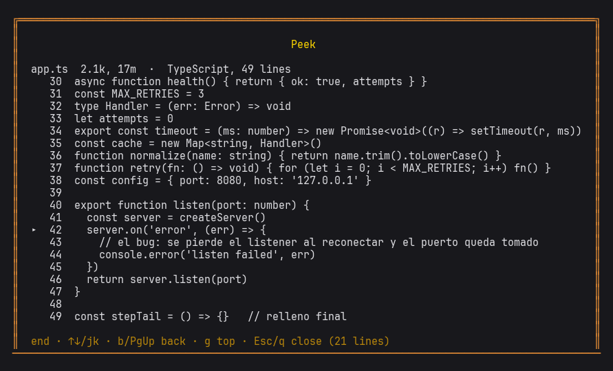

# better-peek

The paths Hermes names in an answer stop being text: `/peek` lists them and shows the file, a widget browses them, and —with the optional patch— the pointer highlights them and a click opens the file inside the TUI.
Las rutas que Hermes nombra en una respuesta dejan de ser texto: `/peek` las lista y muestra el fichero, un widget las navega, y —con el parche opcional— el ratón las resalta y el clic abre el fichero dentro del propio TUI.



```
  El bug esta en src/app.ts:42 y en el lockfile     <- raton: tarjeta con las lineas
                                                       clic: el fichero en el TUI
```

> Adaptación a [Hermes Agent](https://hermes-agent.nousresearch.com) del plugin *quick-peek* de
> [better-claude](https://github.com/midudev/better-claude) de midudev. Forma parte de la familia
> [better-hermes](https://github.com/riverosmejia/better-hermes).

## Qué hace

| Superficie | Qué da | Toca Hermes? |
|---|---|---|
| **Plugin** — `/peek` | Lista las rutas de la última respuesta con su tamaño y edad. `/peek 2` o `/peek src/app.ts:42` abre una con las líneas numeradas y la que nombra marcada. Funciona en el CLI, en el TUI, por SSH y en el gateway, sin ratón. | No: es un plugin normal |
| **Widget** — `/better-peek` | Modal del TUI con la lista: flechas para elegir, Enter para ver el fichero, `c` para copiar `ruta:línea`, Esc para cerrar. | No: un `.mjs` en `tui-widgets/` |
| **Parche** — opcional | Las rutas del transcript como enlaces: resaltado al pasar el ratón, tarjeta con las líneas en la esquina, clic que abre el fichero en el visor del TUI. | Sí: un diff de `ui-tui` |

El plugin y el widget se instalan y desinstalan sin rastro. El parche es lo único que modifica Hermes
por dentro, es idempotente y se revierte con `git checkout -- ui-tui`.

## Instalar

Requisitos: Hermes Agent con el TUI construido una vez (`hermes --tui`) y `python3`. Nada más: la
lógica es Python de biblioteca estándar, sin dependencias. Probado en Hermes `2026.9.24` (Linux).

Solo el plugin (`/peek`), en un comando:

```bash
hermes plugins install riverosmejia/better-peek --enable
```

Y si quieres también el widget del TUI y los parches, desde el repo:

```bash
git clone git@github.com:riverosmejia/better-peek.git
cd better-peek
./install.sh              # copia el plugin, enlaza el widget, habilita y comprueba
```

`install.sh` acepta `--check` (solo comprueba) y `--link` (en vez de copiar, enlaza el checkout, para
desarrollar). Es idempotente.

Para el realce del ratón y la tarjeta en el transcript:

```bash
./patches/apply.sh        # aplica el diff de ui-tui y reconstruye el TUI
./patches/apply.sh --check   # solo dice si encaja con tu versión
```

`apply.sh` comprueba que el parche encaja con tu base antes de tocar nada, y si ya está aplicado no
hace nada. Tras un `hermes update` hay que volver a lanzarlo (el update devuelve el checkout a su
rama).

## Uso

```text
/peek                     las rutas de la última respuesta, numeradas
/peek 2                   esa, con sus líneas y la que nombra marcada
/peek src/app.ts:42       una ruta concreta, aunque no saliera en la respuesta
/better-peek              el modal del TUI (flechas, Enter, c para copiar, Esc)
```

Con el parche, además, el ratón. Si prefieres que el clic abra un editor en vez del visor del TUI,
dilo con `PEEK_OPEN`, que se ejecuta con `{file}` y `{line}` sustituidos y la ruta entrecomillada:

```bash
PEEK_OPEN='tmux new-window nano {file} +{line}' hermes --tui
PEEK_OPEN='code -g {file}:{line}' hermes --tui
```

El realce necesita el ratón del terminal (`display.mouse_tracking` en `all`, el valor por defecto) y
no funciona en tmux con el modo `wheel`, que existe justamente para que el ratón no ensucie el prompt.
Sin él, `/peek`, el clic y el widget siguen funcionando.

## Qué NO hace

- No abre ventanas ni aplicaciones gráficas: todo se dibuja en el terminal.
- No toca ficheros: lee lo que el modelo nombró, si existe.
- Un `file://` escrito por el modelo no dispara nada: los enlaces de ruta usan un esquema propio
  (`hermes-peek://`) que solo fabrica el renderer, y la ruta tiene que existir en esta máquina.
- Una ruta relativa se resuelve desde la carpeta del proceso del TUI, no desde la de la sesión
  después de un `cd`.

## Origen y licencia

Port de *quick-peek* de [better-claude](https://github.com/midudev/better-claude) de **midudev**: las
reglas para encontrar rutas en un texto, resolverlas y sacar las líneas de un fichero vienen de su
`hooks/paths.ts` y `hooks/code.ts`, y sus casos de test son el contrato de este port.

MIT © Miguel Ángel Durán (midudev) y riverosmejia. Ver [LICENSE](LICENSE).
